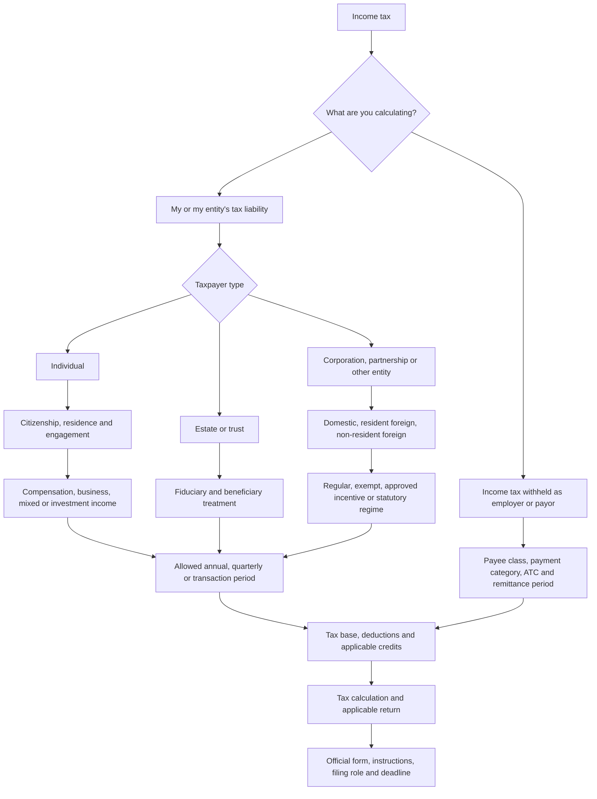

# Income tax calculator: classification, periods, calculations, and BIR forms

**Status: design specification, updated October 18, 2026.** The common calculation routes, classification-dependent periods, form references and directory updates are now implemented for local review. See [implementation review notes](implementation-review.md) for the delivered coverage, checks and explicitly unsupported specialist cases. This document remains the broader design specification.

**Starting source:** [BIR Income Tax](https://www.bir.gov.ph/income-tax), checked in the live browser, including its expanded sections. The page confirms the return families and deadlines, but still shows legacy graduated/corporate rates and some pre-CMEPA investment treatment. Use newer applicable laws, issuances, and actual return instructions to resolve conflicts. Never use an old printed rate simply because it appears on an official form.

The companion [BIR forms and deadlines reference](income-tax-forms.md) contains direct official form links, filing roles, conditions, and deadline rules.

## 1. Recommended product flow

**Taxpayer → classification → income/tax treatment → filing period → relevant amounts and credits → calculation and BIR forms.**

Use a two-column desktop layout: conditional inputs on the left; calculation and form reference on the right. On mobile, results follow inputs. One visible income calculation at a time; additional income streams can be added to an annual reconciliation without mixing final-tax income into the graduated base.

The result panel must show:

- Taxpayer classification, selected regime, tax year, exact covered dates, and calculation purpose.
- Tax base, deductions used, rate or bracket formula, and tax liability before credits.
- Eligible withholding credits, prior payments and other credits, separately identified.
- **Amount payable** or **excess credits/overpayment**. A negative balance is not an automatic cash refund.
- Recommended BIR return and reason; direct **Open BIR form** and **Instructions** links; supporting certificates; who files each document; statutory deadline and any verified applicable adjustment.
- Applicable issuance, effective dates, form version, and date last verified.

No contribution or take-home-pay calculations. Taxable compensation can be entered directly after applicable exclusions; the calculator must not silently treat gross salary as taxable salary.

## 2. Classification model

Citizenship/residence, income source, filing size, deduction method, incentive registration, and filing role are distinct decisions. Do not put them in one “type of compensation earner” dropdown.

| Taxpayer group | Classifications to represent | Source and treatment routing |
| --- | --- | --- |
| Individual | Resident citizen; non-resident citizen/OFW where legally applicable; resident alien; non-resident alien engaged in trade/business (NRAETB); non-resident alien not engaged (NRANETB) | Resident citizens generally have worldwide scope. Other classes generally have Philippine-source scope; apply income-category exceptions and treaties. Graduated rates apply to qualifying ordinary income; NRANETB generally has a separate gross-basis 25% treatment, with category-specific exceptions. |
| Individual income profile | Pure compensation; pure business/sole proprietor; professional; mixed compensation and business/profession; non-business ordinary income; final-tax income; capital gains | Select returns and bases by income nature. A prize or investment gain is not necessarily subject to final tax. |
| Individual exemption/status | Qualified minimum-wage earner; exempt income; foreign-source income outside Philippine scope; treaty or special-law relief | Test the relevant income, not just the person's label. Zero tax does not always mean no return. Verify substituted filing separately. |
| Estate or trust | Taxable estate during settlement, taxable trust, beneficiary/distribution arrangements, exempt trust where qualified | Income earned by an estate/trust uses a fiduciary income-tax route, generally 1701/1701Q as applicable. Estate tax on transfer at death is a separate tax and excluded. Fiduciary deductions and beneficiary allocations require their own verified rules. |
| Non-individual, regular | Domestic corporation; resident foreign corporation; taxable partnership/association/JV; taxable GOCC or instrumentality | Regular corporate route where applicable. Separate worldwide domestic income from Philippine-source foreign-corporation income. |
| Non-individual, foreign recipient | Non-resident foreign corporation | Normally route Philippine income payments to category-specific final withholding, not automatic 1702Q/1702-RT filing. |
| Non-individual, exempt/pass-through | Qualified Section 30 entity, qualified exempt institution/cooperative, general professional partnership (GPP), qualifying excluded JV | Establish legal exemption and treatment of each activity. GPPs are distinct from taxable partnerships; members' distributive shares route to their own returns. Exempt income-information filing can still apply. |
| Non-individual, preferential | Qualifying proprietary school/nonprofit hospital; approved RBE under ITH, SCIT, EDR or transitional regime; entities governed by special laws | Require legal basis, registered activity and effective dates. An RBE/PEZA label alone cannot choose a rate or exemption. |
| Specialist statutory cases | International carriers, offshore/foreign-currency banking, regional headquarters, specified foreign lessors/film owners, accredited microfinance NGOs and other special-law entities | Provide a dedicated branch with its statutory base, ATC, return and verification status. Do not silently fall back to generic 25%/20%. No numeric estimate until the specific rules are verified. |

Sources: [BIR RMC 97-2021, income-source scope](https://bir-cdn.bir.gov.ph/local/pdf/RMC%20No.%2097-2021.pdf); [1700, including NRANETB compensation schedule][1700]; [BIR corporate rate update, RR 7-2025](https://bir-cdn.bir.gov.ph/BIR/pdf/RR%207-2025.pdf); [BIR current investment treatment, RR 21-2025](https://bir-cdn.bir.gov.ph/BIR/pdf/RR%20No.%2021-2025%20Digest.pdf).

For business filers, also ask for their **registered micro/small/medium/large classification** when it affects form selection. This is separate from 8% eligibility and the corporate 20% income/assets test. Confirm the registered status; do not infer it from one quarter's sales.

## 3. Period choices must follow the calculation

| Calculation | Period offered | Required time inputs | Return routing |
| --- | --- | --- | --- |
| Employee's compensation liability | Annual | Calendar year; actual annual taxable compensation; employers and withholding certificates | [1700][1700] if personally required; [2316][2316] and substituted-filing outcome where qualified |
| Compensation planning estimate | Monthly amount projected for a year, clearly labelled an estimate | Monthly taxable compensation; projection assumption | Show annual estimate and monthly equivalent. This is not a monthly personal ITR. |
| Individual business/professional or mixed-income business component | Q1, Q2, Q3, Annual | Calendar year; selected quarter; January-to-quarter-end totals or quarter ledger | [1701Q][1701Q]; annual [1701][1701], [1701A][1701A], or eligible [1701-MS][1701-MS] |
| Taxable estate/trust | Q1–Q3 or annual where required | Applicable year; fiduciary details; cumulative income and permitted distributions/deductions | [1701Q][1701Q]/[1701][1701], with MS eligibility checked separately |
| Regular taxable corporation/entity | Q1, Q2, Q3, Annual | Calendar/fiscal year; year start/end; quarter end; commencement year; short-period status | [1702Q][1702Q]; annual [1702-RT][1702-RT] |
| Corporate special/multiple regimes | Applicable Q1–Q3 and annual, by regime | Fiscal/calendar dates; activity and incentive dates; separate income buckets | [1702Q][1702Q] where required; annual [1702-MX][1702-MX] |
| Fully exempt entity/GPP | Annual information/return view | Taxable-year dates; proof of exemption and taxable-activity check | [1702-EX][1702-EX] where applicable; no automatic quarterly tax obligation |
| Real-property capital gains | Per transaction; qualifying installment schedules | Transfer/contract date; receipt dates for installments | [1706][1706] |
| Unlisted-share gains | Per transaction plus annual reconciliation | Transaction date; taxable year; gain/loss ledger; prior CGT paid | [1707][1707] and [1707-A][1707-A] |
| Passive final-tax income or branch remittance | Per income payment, with payor's remittance-period aggregation | Payment/credit date; instrument issue/maturity dates if relevant; remittance quarter | Category-specific [1601-FQ][1601-FQ] or bank-interest [1602Q][1602Q]; recipient [2306][2306] |
| Employer/payor remittance | Monthly and/or quarterly according to return | Calendar month/quarter; filing channel/eFPS group; withheld amounts and prior remittances | [1601-C][1601-C], [0619-E][0619-E]/[0619-F][0619-F], [1601-EQ][1601-EQ]/[1601-FQ][1601-FQ], or specialist return |

**No Q4 1701Q or 1702Q:** use the full-year annual return. Quarterly withholding returns, such as 1601-EQ/FQ, do have Q4. Corporate fiscal quarters follow the entity's year, not automatically calendar quarters; withholding remittance quarters follow their prescribed calendar periods.

**Input mode:** “Enter cumulative totals” or “Enter each quarter.” For Q2/Q3, show the covered dates and require January/year-start through selected-quarter-end totals. If the user supplies only the latest quarter, request earlier-quarter data rather than treating it as year-to-date. Never multiply quarterly income by four or divide annual liability by four to produce a return calculation.

Sources: [1701Q, cumulative schedules][1701Q]; [1702Q, cumulative regular/MCIT schedules and first-three-quarter filing instructions][1702Q].

## 4. Calculation specification

### A. Graduated schedule

Let `G(T)` be the following calculation on the non-negative taxable base `T`, with the schedule selected by tax year. The current schedule starts January 1, 2023:

| Taxable base | G(T) |
| --- | --- |
| Up to ₱250,000 | 0 |
| Over ₱250,000 to ₱400,000 | 15% × (T − ₱250,000) |
| Over ₱400,000 to ₱800,000 | ₱22,500 + 20% × (T − ₱400,000) |
| Over ₱800,000 to ₱2,000,000 | ₱102,500 + 25% × (T − ₱800,000) |
| Over ₱2,000,000 to ₱8,000,000 | ₱402,500 + 30% × (T − ₱2,000,000) |
| Over ₱8,000,000 | ₱2,202,500 + 35% × (T − ₱8,000,000) |

The fixed amount accounts for lower brackets; do not tax the whole base at its marginal rate. Source: [BIR RR 11-2018, page 29](https://bir-cdn.bir.gov.ph/local/pdf/Digest%20RR%2011-2018.pdf).

### B. Compensation and substituted filing

Annual tax = `G(actual annual taxable compensation + other ordinary income reportable on this return)`, subject to classification. Deduct eligible 2316 withholding and other permitted credits to calculate the balance. For multiple employers, consolidate income and certificates without duplicating transferred prior-employer figures. Compute spouses separately where applicable.

Ask employer count, presence of business income, correct withholding and substituted-filing qualifications before saying that 1700 is required. The existence of an estimate does not establish an obligation to self-file. NRANETB compensation uses its own applicable schedule, not G(T).

For a future payroll-withholding mode, request payroll frequency, taxable regular/supplementary compensation and required cumulative information; use the BIR payroll withholding rules. Do not call `annual tax / 12` exact monthly withholding. Employer remittance aggregates actual payroll tax withheld; it must not recompute tax by applying a bracket to the employer's combined payroll. Source: [1700][1700] and [BIR RR 11-2018](https://bir-cdn.bir.gov.ph/local/pdf/Digest%20RR%2011-2018.pdf).

### C. Individual business/professional: graduated, quarterly or annual

Offer direct entry of an already determined taxable business base, or a guided calculation:

- Itemized: net sales − permitted cost of sales/services − allowed itemized deductions + other ordinary taxable business income, adjusted for applicable tax rules.
- Individual OSD: net sales − 40% of that OSD sales base + applicable other taxable income. Do not deduct cost of sales or itemized expenses again.
- Quarter: `G(cumulative taxable business income through Q1/Q2/Q3)`.
- Annual pure business: `G(full-year taxable business income)`.
- Annual mixed income using graduated business treatment: `G(annual taxable compensation + annual taxable business income)`.

For mixed-income **quarterly** 1701Q, exclude compensation and its 2316 withholding; include both in the annual reconciliation. Treat the elected deduction method consistently for the year. Separate income subject to final tax. Sources: [1701Q][1701Q], [1701A][1701A], and [BIR Income Tax, quarterly individual instructions](https://www.bir.gov.ph/income-tax).

### D. Elected 8%: quarterly or annual

Let `R` be cumulative qualifying net sales plus qualifying other non-operating income for the covered period.

- Purely self-employed: `8% × max(0, R − ₱250,000)`.
- Mixed-income business component: `8% × R`; no second ₱250,000 reduction.
- Annual mixed total: `G(annual taxable compensation) + 8% business tax`.

The ₱250,000 reduction is applied to cumulative income, not newly deducted from each quarter in isolation. Gate eligibility using the applicable threshold, VAT status, timely election and exclusions, including GPP-related restrictions. Crossing the eligibility threshold requires recomputation under the applicable graduated rules with credit for prior payments; do not merely cap the base. No itemized/OSD expense deduction on the 8% base. Source: [BIR RMO 23-2018](https://bir-cdn.bir.gov.ph/local/pdf/RMO%20NO.23-2018.pdf).

### E. Credits and current-period balance

For quarterly business and regular corporate returns, compute cumulative liability first. Then deduct each eligible credit once: prior-quarter cash tax payments, cumulative creditable withholding, available prior-year credits and other allowed credits. Include tax paid on the superseded same-period return only for an amendment. Track amounts by source/period so prior withholding already reflected in payments is not counted twice.

For the annual return, recompute actual full-year liability and deduct eligible annual credits and payments. Separate 2316 compensation withholding from 2307 business withholding. Foreign-tax and MCIT carryover credits require their own eligibility, expiry and limitation rules; they are not unrestricted deductions. A final tax documented by 2306 is not a generic credit against ordinary income tax.

Source: credit schedules on [1701][1701], [1701A][1701A], [1701Q][1701Q], [1702-RT][1702-RT] and [1702Q][1702Q].

### F. Corporations: regular and minimum tax

On the cumulative quarter or full-year base:

- RCIT = applicable rate × non-negative net taxable income: generally 25%; qualifying domestic corporations may use 20% when both annual income and qualifying-assets conditions are met.
- MCIT = 2% × the separately determined MCIT gross-income base when applicable. Gross sales, net taxable income and MCIT gross income are different fields.
- Compare RCIT and MCIT for the regular-tax activity. Do not add them together. A loss for RCIT does not automatically eliminate MCIT.
- Show separately any usable unexpired excess-MCIT carryover against normal tax, following the applicable return's sequence and limitations; then apply other credits and prior payments. Do not offset such carryovers indiscriminately against MCIT or incentive tax.

Ask commencement year and taxable-year dates to determine MCIT eligibility. For commencement in 2023 with calendar years, the fourth following taxable year is 2027. Do not divide annual corporate eligibility thresholds by four. Recheck the applicable rate and annual tests during reconciliation.

For a guided corporate base, reconcile book income to taxable income and ask for the elected allowable deduction method. Corporate OSD, where eligible, uses 40% of its legally defined **gross income**, unlike the individual's sales-based OSD; do not reuse the individual deduction formula. Keep NOLCO and excess-MCIT carryovers as different schedules with separate expiry/application rules.

Keep special/exempt/regular activity buckets separate. For EDR, the registered-activity corporate rate is 20% from November 28, 2024; unregistered income follows its applicable rules. Qualifying institutional 10% treatment and the unrelated-business test require a separate branch. ITH/SCIT/EDR and historical transition periods must never be selected by company name alone.

For the preferential/incentive branch, show a separate calculation for each activity:

| Verified regime | Calculation design | Additional inputs |
| --- | --- | --- |
| ITH | Zero income tax on income demonstrably covered by the approved holiday; compute non-covered income separately | Approval, covered activity, holiday start/end and split-period income |
| Approved SCIT | 5% of the regime-specific gross-income-earned base where the approved regime applies | Eligible direct costs and gross-income definition; registration and transition dates; applicable allocation/reporting requirements |
| EDR | 20% of registered-activity taxable income after verified permitted enhanced deductions | Qualifying deductions and activity allocation; effective dates |
| Qualifying school/nonprofit hospital | 10% of the relevant taxable base if qualified; test the unrelated-business condition before applying preferential treatment | Legal qualification; related/unrelated gross income; taxable income |
| Fully exempt/pass-through activity | No entity income tax on the legally exempt/pass-through base; still determine information-return obligations | Exemption basis and activity scope; partner/beneficiary allocation where applicable |
| Special statutory or treaty regime | Statutory/treaty-specific base and formula; no generic rate fallback | Exact regime, ATC, legal basis, eligibility, dates and supporting approval |

The SCIT gross-income-earned base is not necessarily the same as RCIT taxable income or MCIT gross income. Verify the approved regime and its allocation rules before summing results. [BOI CREATE MORE incentive routes](https://www.boi.gov.ph/wp-content/uploads/2025/02/Doing-Business-in-the-Philippines-2025.pdf).

Sources: [BIR RR 7-2025](https://bir-cdn.bir.gov.ph/BIR/pdf/RR%207-2025.pdf), [RMC 69-2023](https://bir-cdn.bir.gov.ph/local/pdf/RMC%20No.%2069-2023%20v2.pdf), [RR 3-2022](https://bir-cdn.bir.gov.ph/local/pdf/RR%20No.%203-2022.pdf), and [1702Q schedules][1702Q].

### G. Capital gains and investment income

| Case | Base and calculation | Form/period |
| --- | --- | --- |
| Qualifying Philippine real-property capital asset | 6% × highest applicable selling price, BIR zonal value or assessor fair market value; verify seller eligibility, property scope and exemptions | [1706][1706], transaction-based; do not apply universally to foreign corporations or ordinary assets |
| Domestic unlisted shares, qualifying capital asset | 15% × qualifying positive net gain after allowable basis/costs | [1707][1707], transaction-based |
| Annual unlisted-share consolidation | Apply permitted annual gain/loss netting and 15% tax; deduct transaction CGT already paid | [1707-A][1707-A]; do not charge the transaction tax a second time |
| Bank deposits, dividends, royalties, prizes and winnings | Select the verified classification/category-specific final-tax rate, or route to ordinary income/exemption where required | Payment calculation; payor's [1602Q][1602Q] for covered deposit interest or [1601-FQ][1601-FQ] for other covered final taxes; [2306][2306] certificate |
| Branch profit remittance | Generally 15% of profits applied/earmarked for remittance, with treaty/regime exceptions | Separate payment/remittance calculation; generally [1601-FQ][1601-FQ], not additional RCIT on the same base |

For covered ordinary Philippine-source receipts of an NRFC or NRANETB, the general gross-basis route is 25% before applying a verified category-specific exception, exemption or treaty. Do not give these recipients ordinary business expense deductions by default.

Investment treatment must include issue/maturity/transaction dates and grandfathering. Under the post-July-2025 rules, common deposit interest is generally 20% for covered resident recipients, domestic-corporation dividends to qualifying individuals are generally 10%, and passive royalties generally 20% with the literary/book/music exception. Non-resident and intercorporate cases can differ. Do not offer a free “10%–20%” rate selector.

CMEPA also broadened certain unlisted-share treatment to foreign-company shares. The reviewed 2021 forms still describe domestic shares: show the new-law branch in the classification map but mark the exact filing mechanics as requiring current BIR confirmation before enabling calculation/form completion. Listed shares and securities-dealer ordinary assets must be classified first; stock transaction tax is a separate route, not automatically CGT.

Sources: [1706][1706], [1707][1707], [1707-A][1707-A], and [BIR RR 21-2025 digest](https://bir-cdn.bir.gov.ph/BIR/pdf/RR%20No.%2021-2025%20Digest.pdf).

### H. Withholding agents

Withholding is a separate role. The same company can calculate its own corporate tax and remit tax withheld from employees/suppliers, but these are distinct obligations.

For expanded/final withholding, classify the payment and recipient, select the verified ATC and rate, and calculate withholding on the proper payment base. Quarterly remittance reconciles that quarter's withholding against its already remitted amounts; it is not the cumulative graduated income-tax computation. Include 0619-E/F for the first two months where applicable, plus special deposit-interest and fringe-benefit returns. Employer-borne fringe-benefit tax needs its own eligibility and gross-up formula, not the employee compensation calculator.

See the [withholding forms and certificate registry](income-tax-forms.md#withholding-agent-returns-and-supporting-certificates).

## 5. Worked examples for the proposed engine

The following are simplified acceptance examples with no special relief, penalties or additional deductions/credits beyond those stated. Amounts are already taxable unless a gross 8% base is specified.

| Scenario | Calculation | Expected result |
| --- | --- | --- |
| Annual compensation: ₱600,000; 2316 tax withheld ₱60,000 | G(600,000) = 62,500; less 60,000 | ₱2,500 annual balance; 1700 only if personally required |
| Graduated business Q2: YTD taxable income ₱600,000; Q1 cash payment ₱20,000; cumulative 2307 credits ₱5,000 | 62,500 − 20,000 − 5,000 | ₱37,500 Q2 balance; 1701Q, not 62,500 ÷ 4 |
| Pure 8% business: Q1 gross base ₱300,000; Q2 YTD base ₱700,000; Q1 cash payment ₱4,000 | Q1 = 8% × 50,000; Q2 YTD tax = 8% × 450,000; less 4,000 | Q1 ₱4,000; Q2 balance ₱32,000 |
| Mixed 8%: annual taxable compensation ₱600,000 and business gross base ₱700,000 | 62,500 + 56,000 | ₱118,500 liability before credits; quarterly business filings exclude compensation |
| Eligible MCIT corporation, Q2 YTD regular taxable income ₱100,000; MCIT gross income ₱2m; assume 25% RCIT and prior cash payment ₱10,000 | RCIT 25,000; MCIT 40,000; controlling tax 40,000; less 10,000 | ₱30,000 current balance, before other credits |
| Qualifying real-property sale: price ₱3m; zonal ₱3.5m; assessor FMV ₱3.2m | 6% × 3.5m | ₱210,000; 1706, transaction date required |
| Qualifying unlisted shares: annual gains ₱200,000; allowed losses ₱50,000; transaction CGT already paid ₱30,000 | 15% × 150,000 − 30,000 | ₱7,500 excess payment on 1707-A; no automatic cash refund |

## 6. Form-selection and deadline rules

- **1700:** establish self-filing/substituted-filing outcome; attach/reference 2316.
- **1701A:** pure business/professional income with OSD or eligible 8% treatment; not the default for mixed income or itemized deductions.
- **1701-MS:** qualifying registered micro/small filers only. Its instructions require 1701 for two or more activities or multiple tax regimes/rates. Do not blindly select MS from turnover alone. The form contains mixed-income schedules, so validate the specific activity/regime combination rather than blanket excluding or including every mixed-income filer.
- **1701:** mixed/itemized or other eligible individual/fiduciary cases after testing the more specific annual routes. For mixed graduated/8% regimes, apply the form's multiple-regime restriction when considering MS.
- **1702-RT/EX/MX:** regular-only, fully exempt with no other taxable income, or special/multiple-rate routes respectively. An exempt entity with taxable activity must not be automatically given EX.
- **1701Q/1702Q:** applicable first three quarters; annual return is the year-end reconciliation.
- **1706/1707/1707-A:** transaction/annual-CGT routes; not ordinary business quarterly returns.
- **160x/0619x:** payor remittances; **2306/2307/2316:** certificates, not interchangeable taxpayer returns.

Deadline inputs include year, fiscal close where permitted, quarter, transaction/receipt date and filing channel/eFPS group. Show the statutory rule first. Apply verified weekends/holidays and location/taxpayer-specific extension issuances to derive the actual deadline. Preserve the original statutory date and extension source; do not hardcode a permanent April 15 or generic “10th/15th” for every situation. No balance due does not necessarily remove a filing obligation.

MS filing-channel rules must be current: [RMC 37-2026](https://bir-cdn.bir.gov.ph/BIR/pdf/RMC%20No.%2037-2026%20Digest.pdf) introduced 1701-MS electronic filing through eBIRForms 7.9.6, updating the earlier [RMC 20-2026](https://bir-cdn.bir.gov.ph/BIR/pdf/RMC%2020-2026.pdf). Do not describe MS as manual-only or assume every form exists on every channel.

## 7. Implementation and verification plan

1. Build a versioned classification/form registry and a period resolver before adding calculator screens. Each route stores allowed periods, income-source scope, base definition, method, form/version, filer role, dates, credits, rounding and sources.
2. Add annual compensation filing guidance and a clearly separate planning-estimate mode to the existing calculator. Add substituted-filing questions and 2316 credits.
3. Add individual business and mixed-income quarterly/annual reconciliation with 8% and OSD/itemized gates.
4. Add ordinary corporate/fiscal-year and RCIT/MCIT flows; then special activity buckets.
5. Add transaction CGT, annual share reconciliation and recipient-specific investment cases; then employer/payor remittance flows.
6. Cover fiduciaries, exemption/pass-through cases and specialist statutory entities with verified dedicated rules. Show an explicit eligibility/verification gap rather than silently issuing a generic result.

Release checks must cover bracket edges; zero versus missing inputs; negative losses; annual/quarterly consistency; 8% election/threshold changes; no compensation in 1701Q; no duplicate credits; no Q4 individual/corporate quarterly return; fiscal and short years; MCIT start year and carryovers; exemption boundaries; spouse separation; amended returns; actual-form rounding; updated rate versus old form text; and deadline exceptions. Use decimal/integer monetary arithmetic, preserve full calculation trace, and apply each form's prescribed rounding at the appropriate lines.

**Coverage boundary:** this is a comprehensive routing and calculation design, not a claim that every treaty, statutory incentive, fiduciary election or foreign-investment filing mechanic has already been verified. Those branches are represented explicitly and must be completed before numerical estimates are enabled. VAT, percentage tax, DST, estate tax, donor's tax and social contributions are outside this income-tax calculator.

[1700]: https://bir-cdn.bir.gov.ph/local/pdf/1700%20Jan%202018%20ENCS%20v6.pdf
[1701]: https://bir-cdn.bir.gov.ph/local/pdf/1701%20Jan%202018%20final%20with%20rates.pdf
[1701A]: https://bir-cdn.bir.gov.ph/local/pdf/1701A%20Jan%202018%20v5%20with%20rates.pdf
[1701-MS]: https://bir-cdn.bir.gov.ph/BIR/pdf/1701-MS%20August%202024%20Fillable_01.pdf
[1701Q]: https://bir-cdn.bir.gov.ph/local/pdf/1701Q%20Jan%202018%20final%20rev2_copy.pdf
[1702-RT]: https://bir-cdn.bir.gov.ph/local/pdf/1702-RT%20Jan%202018%20ENCS%20Final%20v3.pdf
[1702-EX]: https://bir-cdn.bir.gov.ph/local/pdf/1702-EX%20Jan%202018%20ENCS%20v2.pdf
[1702-MX]: https://bir-cdn.bir.gov.ph/local/pdf/1702-MX%20Jan%202018%20ENCS%20Final%20with%20OSDv2.pdf
[1702Q]: https://bir-cdn.bir.gov.ph/local/pdf/1702Q%202018ENCS%20final2.pdf
[1706]: https://bir-cdn.bir.gov.ph/local/pdf/1706%20Jan%202018%20ENCS%20Final%20version.pdf
[1707]: https://bir-cdn.bir.gov.ph/local/pdf/1707%20April%202021%20ENCS.pdf
[1707-A]: https://bir-cdn.bir.gov.ph/local/pdf/1707-A%20April%202021%20ENCS.pdf
[1601-C]: https://bir-cdn.bir.gov.ph/local/pdf/1601C%20final%20Jan%202018%20with%20DPA.pdf
[0619-E]: https://bir-cdn.bir.gov.ph/local/pdf/0619-E%20Jan%202018%20rev%20final.pdf
[0619-F]: https://bir-cdn.bir.gov.ph/local/pdf/0619-F%20Jan%202018%20rev%20final.pdf
[1601-EQ]: https://bir-cdn.bir.gov.ph/local/pdf/1601-EQ%20January%202019%20ENCS%20final.pdf
[1601-FQ]: https://bir-cdn.bir.gov.ph/local/pdf/1601-FQ%202020%20final.pdf
[1602Q]: https://bir-cdn.bir.gov.ph/local/pdf/1602Q%20Jan%202019.pdf
[2306]: https://bir-cdn.bir.gov.ph/local/pdf/2306%20Jan%202018%20ENCS%20v4.pdf
[2316]: https://bir-cdn.bir.gov.ph/local/pdf/2316%20Sep%202021%20ENCS_Final_corrected.pdf
